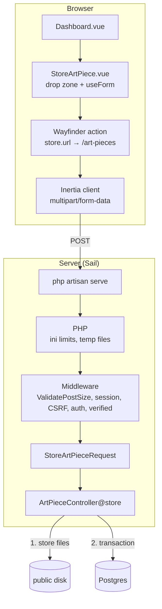

# Feature: Art Piece Image Upload

Images are attached to an art piece through a drag-and-drop zone in the
dashboard's "Add Art Piece" dialog. They are uploaded with the form in a
single multipart request, stored on a filesystem disk, and their paths
are saved in `art_piece_images`.

**Status (2026-11-07):** implemented locally on the `public` disk.
S3, thumbnails and admin-only authorization are pending (see Open items).

## Behavior

- Accepts JPG, PNG and WebP: up to 19 images per piece, 10 MB per
  image, 80 MB in total.
- Limits are enforced when files are added, before anything is uploaded.
  The type is checked by file extension, since browsers sometimes report
  an empty MIME type for real images.
  A file isn't added if it's the wrong type, over 10 MB, past the 19th
  image, or would push the total over 80 MB. A notice names what was
  skipped and why (for the total, it also shows how much space is left).
  When either the count or the total is reached, the drop zone is
  disabled. Server-side validation still applies to every request.
- Each preview shows the file name, type and size (e.g.
  "JPEG · 4.2 MB").
- A summary shows both limits and a meter: "3 of 19 images · 14.2 MB
  of 80.0 MB", plus "N% full". The percentage is whichever limit is
  closer to being reached, `max(count / max_images, size / max_total)`,
  so it reads 100% when either one is.
- Previews are rendered locally (`URL.createObjectURL`) before upload.
  Each one can be removed.
- Upload progress is shown during submit. On success the dialog
  closes and a toast is flashed. Validation errors are shown per field
  and per image (`images.N`).
- Image order in the form sets `art_piece_images.position`.
- Requires an authenticated user with a verified email.

## Supported image types

Uploaded files are shown to visitors as-is, in an `` tag. So a type
is accepted only if (1) every major browser can display it, (2) it suits
photographs of artwork, and (3) it's safe to serve back to visitors.
JPEG, PNG and WebP are the only common types that meet all three.

| Type                   | Status                   | Reason                                                                                                                                                                                                                                                                                           |
| ---------------------- | ------------------------ | ------------------------------------------------------------------------------------------------------------------------------------------------------------------------------------------------------------------------------------------------------------------------------------------------ |
| JPEG                   | Accepted                 | Universal; the default output of cameras, phones and most scanners                                                                                                                                                                                                                               |
| PNG                    | Accepted                 | Universal; lossless, suited to scans and line art                                                                                                                                                                                                                                                |
| WebP                   | Accepted                 | Supported by all current browsers; smaller than JPEG at similar quality                                                                                                                                                                                                                          |
| HEIC/HEIF              | Not accepted             | iPhone's default format. Most browsers outside Safari can't display it, and GD can't read it. iOS usually converts to JPEG when a photo is picked through a browser upload, which reduces the need. Supporting it means converting to JPEG/WebP on upload (Imagick can; it's available in Sail). |
| AVIF                   | Not accepted (candidate) | Current browsers support it and it compresses better than WebP. GD supports it in Sail, but production PHP may not. Add it once the production host's PHP is confirmed to support it.                                                                                                            |
| TIFF                   | Not accepted             | Common for archival scans, but browsers can't display it and the files are very large. Would need conversion on upload.                                                                                                                                                                          |
| GIF                    | Not accepted             | Limited to 256 colors, which is poor for photographs; animation isn't needed here.                                                                                                                                                                                                               |
| SVG                    | Not accepted             | Can contain scripts. Serving uploaded SVGs from the app's domain is a cross-site scripting (XSS) risk. Laravel's image rules exclude SVG by default for this reason.                                                                                                                             |
| BMP, RAW (CR2, NEF, …) | Not accepted             | Uncompressed or camera-specific; browsers can't display RAW, and neither format offers any benefit over JPEG here.                                                                                                                                                                               |

**To add a type:** add its extension to
`StoreArtPieceRequest::ACCEPTED_IMAGE_EXTENSIONS` (the dialog picks it up
through the `imageUploadLimits` prop). Optionally add a display label in
`extensionLabels` in `StoreArtPiece.vue`. A type browsers can't display
also needs conversion on upload, which the planned thumbnail job could do
(see "Thumbnails"). Then add a test case for it.

## Limit source of truth

`StoreArtPieceRequest::MAX_IMAGES`, `MAX_IMAGE_KILOBYTES` and
`MAX_TOTAL_KILOBYTES` define the limits. The server rules use them
directly (the total via the reusable
[`MaxTotalFileSize`](../../app/Rules/MaxTotalFileSize.php) rule), and
`StoreArtPieceRequest::imageUploadLimits()` sends them to the client as
the `imageUploadLimits` dashboard prop (typed by `ImageUploadLimits` in
[types/art-pieces.ts](../../resources/js/types/art-pieces.ts)). Changing
a constant updates both sides. This includes the accepted file types
(`ACCEPTED_IMAGE_EXTENSIONS`, sent as `accepted_extensions`); the dialog
keeps only display labels for them. Closing the dialog keeps the
selected images as a draft but clears the notices.

## Environments

The application code is identical across environments. The
infrastructure in front of it, and therefore most limits, is not.

| Layer            | Local (Sail)                                                | Production (host TBD)                                                                        |
| ---------------- | ----------------------------------------------------------- | -------------------------------------------------------------------------------------------- |
| Web server       | `php artisan serve` (PHP built-in server; development only) | nginx + PHP-FPM, Octane, or a managed platform                                               |
| Concurrency      | 1 process                                                   | Worker pool                                                                                  |
| Upload buffering | None. The PHP process receives the body.                    | Web server/platform buffers the body before PHP                                              |
| Body size limits | PHP only                                                    | Load balancer, web server (nginx `client_max_body_size` default 1 MB), PHP. The lowest wins. |
| PHP config       | Sail defaults (`memory_limit` unlimited)                    | Host config (`memory_limit` default 128M)                                                    |
| Storage          | `public` disk → `storage/app/public/art-pieces`             | S3                                                                                           |
| Image delivery   | Web server via `public/storage` symlink                     | S3 or CDN                                                                                    |

All limits must be re-verified against the production host before
deployment.

## Architecture (local)

## Write path

| #   | Location                                                                                                                                            | Responsibility                                                                                                                                                                                                                                                                                                                                                                                                                               |
| --- | --------------------------------------------------------------------------------------------------------------------------------------------------- | -------------------------------------------------------------------------------------------------------------------------------------------------------------------------------------------------------------------------------------------------------------------------------------------------------------------------------------------------------------------------------------------------------------------------------------------- |
| 0   | [ArtPieceController.php:34](../../app/Http/Controllers/ArtPieceController.php#L34) → [Dashboard.vue:41](../../resources/js/pages/Dashboard.vue#L41) | Upload limits passed from `StoreArtPieceRequest` to the dialog as the `limits` prop.                                                                                                                                                                                                                                                                                                                                                         |
| 1   | [StoreArtPiece.vue:54](../../resources/js/components/StoreArtPiece.vue#L54)                                                                         | `useForm` state, with `images: File[]`.                                                                                                                                                                                                                                                                                                                                                                                                      |
| 2   | [StoreArtPiece.vue:130](../../resources/js/components/StoreArtPiece.vue#L130)                                                                       | `addFiles`: rejects files by extension, then per-image size (`max_image_bytes`), then count (`max_images`), then remaining total (`max_total_bytes`). Accepted files are appended to `form.images` with preview URLs, and rejection notices are collected. Called from `handleDrop` ([L180](../../resources/js/components/StoreArtPiece.vue#L180)) and the hidden file input ([L185](../../resources/js/components/StoreArtPiece.vue#L185)). |
| 3   | [StoreArtPiece.vue:227](../../resources/js/components/StoreArtPiece.vue#L227)                                                                       | `form.post(store.url())`. Inertia switches to `multipart/form-data` because the payload contains `File` objects. Progress is exposed as `form.progress`.                                                                                                                                                                                                                                                                                     |
| 4   | PHP                                                                                                                                                 | Enforces ini limits and writes the files to temp storage (`$_FILES`).                                                                                                                                                                                                                                                                                                                                                                        |
| 5   | Middleware                                                                                                                                          | `ValidatePostSize` (413 above `post_max_size`), the `web` group (session, CSRF), then `auth` and `verified`.                                                                                                                                                                                                                                                                                                                                 |
| 6   | [routes/web.php:10](../../routes/web.php#L10)                                                                                                       | `POST art-pieces` → `ArtPieceController@store`.                                                                                                                                                                                                                                                                                                                                                                                              |
| 7   | [StoreArtPieceRequest.php](../../app/Http/Requests/StoreArtPieceRequest.php)                                                                        | `images` max `MAX_IMAGES`, and [`MaxTotalFileSize`](../../app/Rules/MaxTotalFileSize.php) totals the file sizes against `MAX_TOTAL_KILOBYTES`; `images.*` must be `File::types(ACCEPTED_IMAGE_EXTENSIONS)->max(MAX_IMAGE_KILOBYTES)`. Type is detected from file contents. This is the authoritative check, since client checks can be bypassed.                                                                                             |
| 8   | [ArtPieceController.php:48](../../app/Http/Controllers/ArtPieceController.php#L48)                                                                  | Inside the `try`: stores each file to `art-pieces/` on `ArtPieceImage::DISK`, recording each path. A `false` return (the disk has `throw => false`) is turned into an exception.                                                                                                                                                                                                                                                             |
| 9   | [ArtPieceController.php:59](../../app/Http/Controllers/ArtPieceController.php#L59)                                                                  | Transaction: insert `art_pieces`, then one `art_piece_images` row per stored path, with its `position`.                                                                                                                                                                                                                                                                                                                                      |
| 10  | [ArtPieceController.php:73](../../app/Http/Controllers/ArtPieceController.php#L73)                                                                  | On any failure (a file that fails to store, or the transaction): delete every file stored so far, then rethrow. No orphan files.                                                                                                                                                                                                                                                                                                             |
| 11  | [ArtPieceController.php:79](../../app/Http/Controllers/ArtPieceController.php#L79)                                                                  | Flash a toast and redirect back.                                                                                                                                                                                                                                                                                                                                                                                                             |

## Read path

| #   | Location                                                                           | Responsibility                                                                                                                             |
| --- | ---------------------------------------------------------------------------------- | ------------------------------------------------------------------------------------------------------------------------------------------ |
| 1   | [ArtPieceController.php:21](../../app/Http/Controllers/ArtPieceController.php#L21) | Paginated pieces with `images` eager-loaded in `position` order (2 queries).                                                               |
| 2   | [ArtPieceImage.php](../../app/Models/ArtPieceImage.php)                            | The `url` accessor returns `Storage::disk(DISK)->url($path)`. Only paths are persisted, so changing disk doesn't require a data migration. |
| 3   | [Dashboard.vue:55](../../resources/js/pages/Dashboard.vue#L55)                     | Renders `images[0]`.                                                                                                                       |
| 4   | Delivery                                                                           | Local: web server via the `public/storage` symlink. Production: S3/CDN. Laravel doesn't serve the image bytes in either case.              |

## Data

| Table              | Columns written                                                                  |
| ------------------ | -------------------------------------------------------------------------------- |
| `art_pieces`       | `name`, `description`, `price_cents`, `status` (`draft`)                         |
| `art_piece_images` | `art_piece_id`, `path` (disk-relative, e.g. `art-pieces/<hash>.jpg`), `position` |

See [schema.md](schema.md).

## Limits (local)

From the Sail container, 2026-11-07:

| Limit                                  | Scope              | Value     | On breach                                   |
| -------------------------------------- | ------------------ | --------- | ------------------------------------------- |
| `post_max_size`                        | entire request     | 100M      | 413 (`PostTooLargeException`)               |
| `upload_max_filesize`                  | per file           | 100M      | file rejected                               |
| `max_file_uploads`                     | files per request  | 20        | excess files silently dropped               |
| `memory_limit`                         | per request        | unlimited | n/a                                         |
| Concurrency (`artisan serve`)          | server             | 1         | requests queue behind uploads               |
| `images` (`MAX_IMAGES`)                | files per form     | 19        | blocked when added; server validation error |
| `images.*` (`MAX_IMAGE_KILOBYTES`)     | per file           | 10 MB     | blocked when added; server validation error |
| `images` total (`MAX_TOTAL_KILOBYTES`) | all files together | 80 MB     | blocked when added; server validation error |

**Constraints:** all images share one request, so:

- `MAX_TOTAL_KILOBYTES` must stay below every body size limit on the
  path (80 MB < 100M `post_max_size` locally), with headroom for the
  text fields and multipart overhead.
- `MAX_IMAGES` must stay **below** `max_file_uploads` (20). PHP drops
  extra files without an error, so with a limit of 20, a 25-file request
  would be cut to 20 and pass. At 19, a request PHP has cut to 20 still
  fails validation.

The count is a cap set by PHP, not a product limit. The total-size
budget is what actually protects the request. Revisit both when the
production host is chosen.

**Transfer time:** about `(MB × 8) ÷ upload Mbps` seconds, plus protocol
overhead. A maximum 80 MB payload takes ~64 s at 10 Mbps upload. A
typical payload (3 × ~5 MB) takes ~12 s.

**Capacity:** reads don't touch the application server. Writes hold one
worker for the duration of the request. At the expected volume (one
admin, ~3 images per piece) uploads have no meaningful effect on
storefront traffic in production.

## Production storage options

### A. Proxy through the application (current design)

Browser → load balancer → web server → PHP → S3. To adopt, set
`ArtPieceImage::DISK = 's3'` and configure credentials.

| Pros                                        | Cons                                                         |
| ------------------------------------------- | ------------------------------------------------------------ |
| No code changes                             | Subject to every layer's body size limit and timeout         |
| Server-side validation of the actual file   | Double transfer (client → app → S3)                          |
| Atomic with the form submission; no orphans | Holds a worker for the whole upload                          |
| Testable with `Storage::fake()`             | Not viable on Lambda-based hosting (payload cap of a few MB) |

### B. Direct-to-S3 via presigned URLs

The client requests a presigned URL per file, PUTs the file to S3, then
submits the form with the object keys. The app verifies the objects
exist and persists the keys.

| Pros                                                         | Cons                                                                 |
| ------------------------------------------------------------ | -------------------------------------------------------------------- |
| File never transits the application tier                     | Presign endpoint, client upload flow, confirmation step              |
| Single transfer; S3 limits (5 GB single PUT, 5 TB multipart) | Validation limited to presign conditions plus post-upload inspection |
| Per-file progress and retry                                  | Orphaned objects from abandoned forms (lifecycle rule needed)        |
| Compatible with serverless hosting                           | Bucket CORS and IAM configuration; harder to test                    |

**Decision:** A, for now. B's benefits are about scale, which doesn't apply
at current volume. Revisit if the chosen host caps request bodies.

## Thumbnails (planned)

The dashboard currently downloads full-size originals for card-sized
display. Planned approach:

- Generate resized derivatives (e.g. 400 px wide) in a queued job
  dispatched after storage.
- Persist the derivative paths alongside the original (see "Deferred"
  in [schema.md](schema.md)).
- Size the queue worker's memory for decoded images, not file size:
  a 6000×4000 RGBA image takes ~96 MB when decoded, which exceeds the
  128M default once processing overhead is added.

## Tests

- [ArtPieceStoreTest.php](../../tests/Feature/ArtPieceStoreTest.php): guest and unverified-user rejection; ordered storage and toast;
  file cleanup when the transaction fails and when a later file fails
  to store; 19 images within 80 MB accepted; validation (non-file,
  disallowed type, SVG, oversize file, more than 19 files); the
  total-size error message.
- [DashboardTest.php](../../tests/Feature/DashboardTest.php): image URLs returned in `position` order; `imageUploadLimits` prop.
- Client-side checks in `StoreArtPiece.vue` have no automated tests (no
  JS test runner is installed).

## Open items

1. **Admin authorization.** Any verified user can create pieces. Add
   an admin gate before launch.
2. **Thumbnails.** See above.
3. **Deletion.** Database cascades don't delete stored files. Piece
   deletion (not yet built) must delete them explicitly.
4. **Production storage.** Confirm option A or B once a host is chosen.
5. **Adding images to an existing piece.** Not supported: images can
   only be attached when the piece is created. Needed if the per-piece
   limit grows beyond what fits in one request, or for per-image upload
   (option B).
6. **Strip location metadata before launch.** Phone photos usually embed
   EXIF data, including GPS coordinates. Originals are served publicly
   as uploaded, so anyone can read where a piece was photographed.
   Removing it requires re-encoding the image (e.g. Imagick
   `stripImage()`), which fits in the thumbnail job. Serve only the
   stripped versions.
7. **Cap image dimensions.** File size doesn't bound decoded size: a
   5 MB PNG can be 30,000 × 30,000 pixels, which takes gigabytes of
   memory to decode. Add `File::image()->dimensions(...)` limits before
   any server-side image processing (thumbnails, metadata stripping)
   ships.
