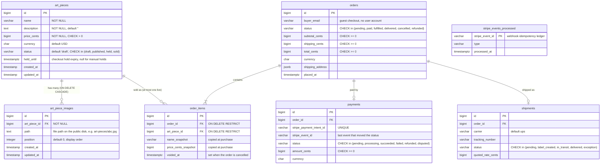
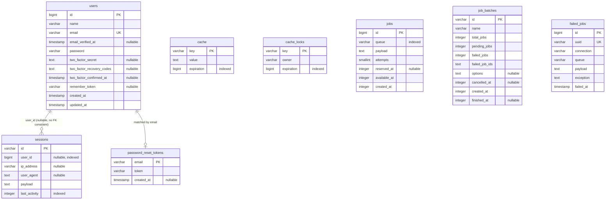
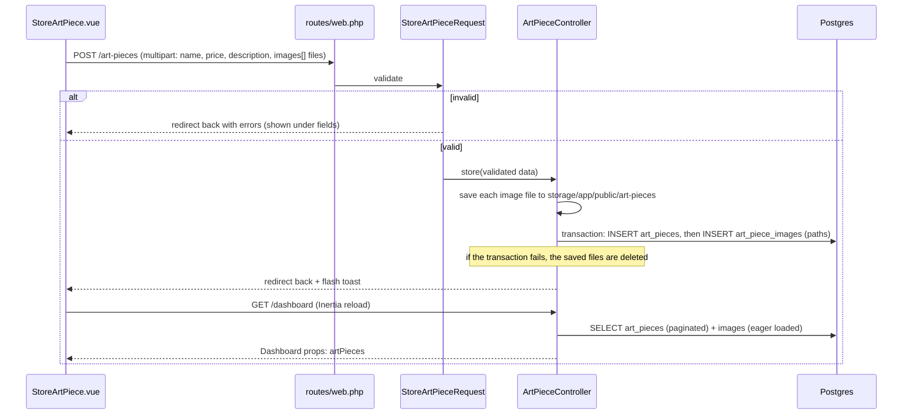

# Art Piece Schema — Design Notes

## Diagram: application tables

These are the tables the app's own features use. GitHub and VS Code's
Markdown preview render Mermaid blocks as diagrams.

`users` are only the people who manage the site, so they aren't linked
to these tables. Buyers check out as guests; an order stores
`buyer_email` instead of a user id.

### Checkout tables: what the database guarantees

Ported from the Fable version, with `user_id` replaced by `buyer_email`.

- **A piece sells once.** A partial unique index,
  `order_items (art_piece_id) WHERE voided_at IS NULL`, allows at most one
  live order item per piece even if two checkouts race past the app code.
  Cancelling an order voids its items, which frees the piece.
- **A Stripe payment is recorded once.** `stripe_payment_intent_id` is
  unique.
- **A webhook event is handled once.** `stripe_events_processed` has the
  event id as its primary key; the handler inserts it first and skips the
  event if it was already there.
- **Statuses are valid.** Each status column has a CHECK constraint that
  mirrors its PHP enum; the enums also define which status changes are
  allowed (see [public-gallery.md](public-gallery.md#key-decisions)).
- **History is kept.** Foreign keys from order data are `RESTRICT`, so a
  piece or order with sales history can't be deleted out from under it,
  and items keep a snapshot of the name and price paid.

## Diagram: framework tables

These are the starter kit / Laravel tables, used for auth, sessions,
cache and queues. They are listed so the whole database is documented
in one place.

## Request flow: how data reaches these tables

## Current tables (v1)

**`art_pieces`**

- `id` — auto-incrementing primary key
- `name` — the piece's title
- `description` — free text, defaults to empty string
- `price_cents` — money stored as an integer count of cents, never a
  float, to avoid rounding errors. `CHECK (price_cents > 0)` — a piece
  worth $0 isn't a real listing.
- `status` — defaults to `'draft'`. `CHECK (status IN ('draft',
'published', 'held', 'sold'))` — the database, not just application
  code, makes an invalid status unrepresentable. In PHP it's cast to
  the `App\Enums\ArtPieceStatus` enum (labels, and `isPublic()`: every
  status but `draft` appears in the public gallery). Which status
  can move to which is enforced in PHP by the enum's state machine
  (`allowedTransitions()`, `ArtPiece::transitionTo()`); see
  [public-gallery.md](public-gallery.md#key-decisions).
- `created_at` / `updated_at`

**`art_piece_images`**

- `id`
- `art_piece_id` — foreign key, `ON DELETE CASCADE` (deleting a piece
  deletes its images with it)
- `path` — where the uploaded file lives on the `public` disk (e.g.
  `art-pieces/abc.jpg`). Only the path is stored, not a full URL; the
  `ArtPieceImage::url` accessor builds the URL from the disk config, so
  moving to S3 later is a config change, not a data migration.
  (Renamed from `url` once drag-and-drop upload replaced URL fields.)
- `position` — integer, for ordering multiple images
- `created_at` / `updated_at`

## Why this schema, and what it's scoped to

This is deliberately scoped to exactly what the current admin "Add Art
Piece" dialog collects: name, description, price, and uploaded image
files. No column exists here that isn't backed by a real, currently-used
field — adding unused columns now would be building for a hypothetical
future requirement rather than the app's actual current state.

## Deferred from the original (Fable-built) schema

An earlier version of this project's schema (`art_pieces` +
`art_piece_images`) included several fields this v1 intentionally
leaves out, since the current form doesn't collect them yet:

- `slug` — a unique, URL-safe identifier for the piece's public page.
  Would be auto-derived from `name` when that public page is built.
- `series`, `year`, `medium`, `width_mm`, `height_mm` — descriptive
  metadata for the physical piece.
- `provenance` (jsonb) — acquisition history, schemaless per piece.
- On images: `is_primary` (which image is the main display photo),
  and resized `derivatives` (thumbnails). Uploads are now real files
  stored by `path` on the local `public` disk; moving them to S3 is a
  later step.

These aren't oversights — they're the next real expansions, added when
the feature that actually needs them gets built, not before.
