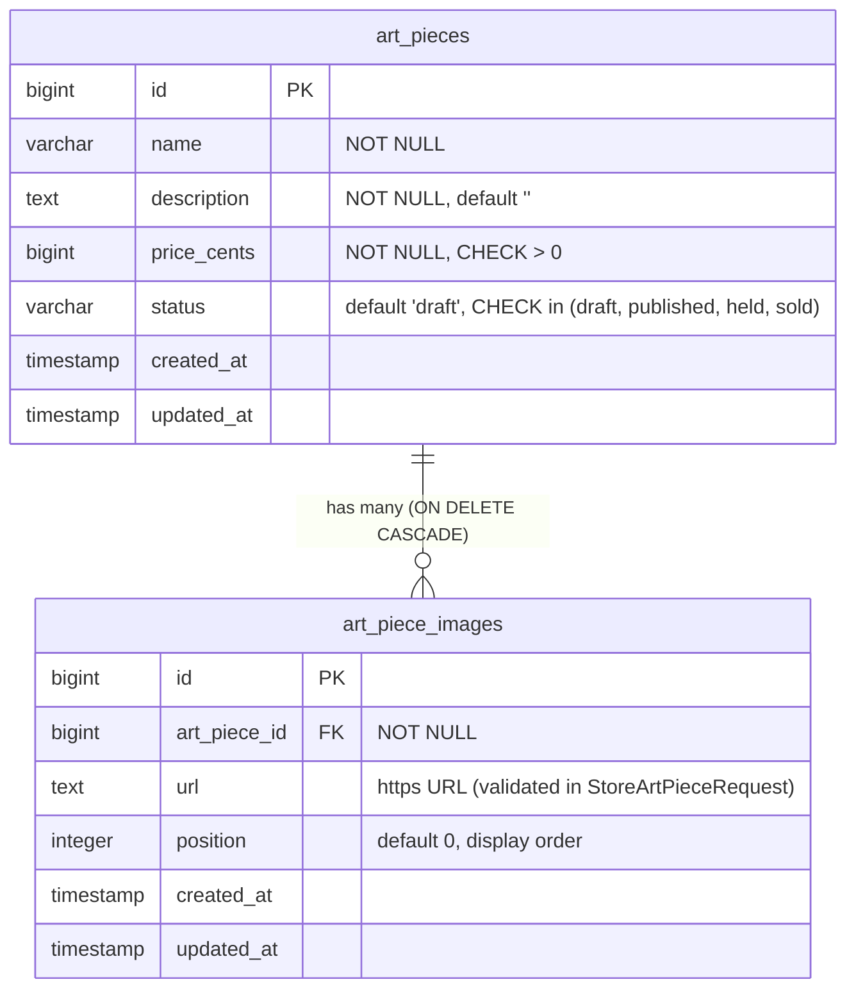
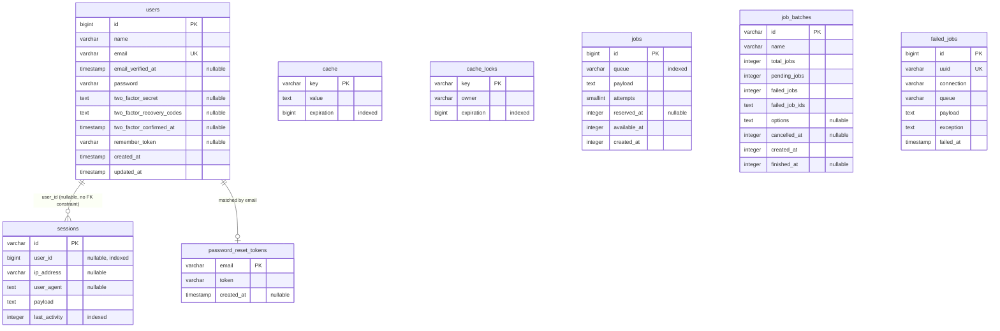
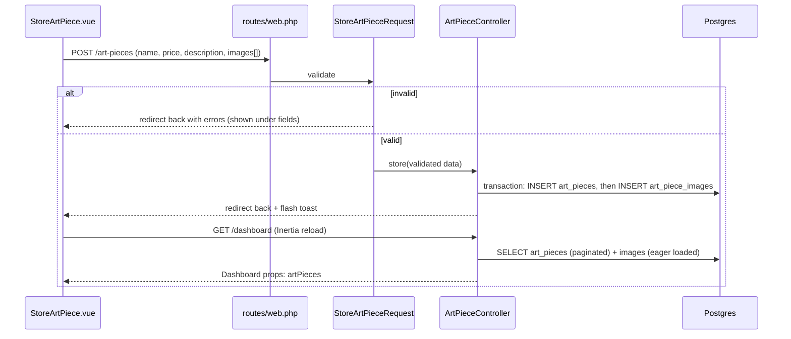

# Art Piece Schema — Design Notes

## Diagram: application tables

These are the tables the app's own features use. GitHub and VS Code's
Markdown preview render Mermaid blocks as diagrams.

`art_pieces` and `users` are not related yet. When the admin concept
and orders exist, the links (who created or bought a piece) will be
added here.

## Diagram: framework tables

These are the starter kit / Laravel tables, used for auth, sessions,
cache and queues. They are listed so the whole database is documented
in one place.

## Request flow: how data reaches these tables

## Current tables (v1)

**`art_pieces`**
- `id` — auto-incrementing primary key
- `name` — the piece's title
- `description` — free text, defaults to empty string
- `price_cents` — money stored as an integer count of cents, never a
  float, to avoid rounding errors. `CHECK (price_cents > 0)` — a piece
  worth $0 isn't a real listing.
- `status` — defaults to `'draft'`. `CHECK (status IN ('draft',
  'published', 'held', 'sold'))` — the database, not just application
  code, makes an invalid status unrepresentable.
- `created_at` / `updated_at`

**`art_piece_images`**
- `id`
- `art_piece_id` — foreign key, `ON DELETE CASCADE` (deleting a piece
  deletes its images with it)
- `url` — plain text URL for now (see "Deferred" below)
- `position` — integer, for ordering multiple images
- `created_at` / `updated_at`

## Why this schema, and what it's scoped to

This is deliberately scoped to exactly what the current admin "Add Art
Piece" dialog collects: name, description, price, and a list of image
URLs. No column exists here that isn't backed by a real, currently-used
field — adding unused columns now would be building for a hypothetical
future requirement rather than the app's actual current state.

## Deferred from the original (Fable-built) schema

An earlier version of this project's schema (`art_pieces` +
`art_piece_images`) included several fields this v1 intentionally
leaves out, since the current form doesn't collect them yet:

- `slug` — a unique, URL-safe identifier for the piece's public page.
  Would be auto-derived from `name` when that public page is built.
- `series`, `year`, `medium`, `width_mm`, `height_mm` — descriptive
  metadata for the physical piece.
- `provenance` (jsonb) — acquisition history, schemaless per piece.
- `currency` — assumed USD for now; add when multi-currency is a real
  requirement, not before.
- `held_until` — part of a `held` status lifecycle (a piece
  temporarily reserved for a buyer). The `status` column already
  allows `'held'` as a value, but the actual hold-expiry logic isn't
  built yet.
- On images: `is_primary` (which image is the main display photo),
  and real object storage (`s3_key_original` / `derivatives`) instead
  of a plain `url` column — this app doesn't have real file upload
  yet; that's planned as its own dedicated build (drag-and-drop image
  upload), after which `url` here will likely become a real storage
  key instead of an arbitrary text field.

These aren't oversights — they're the next real expansions, added when
the feature that actually needs them gets built, not before.
